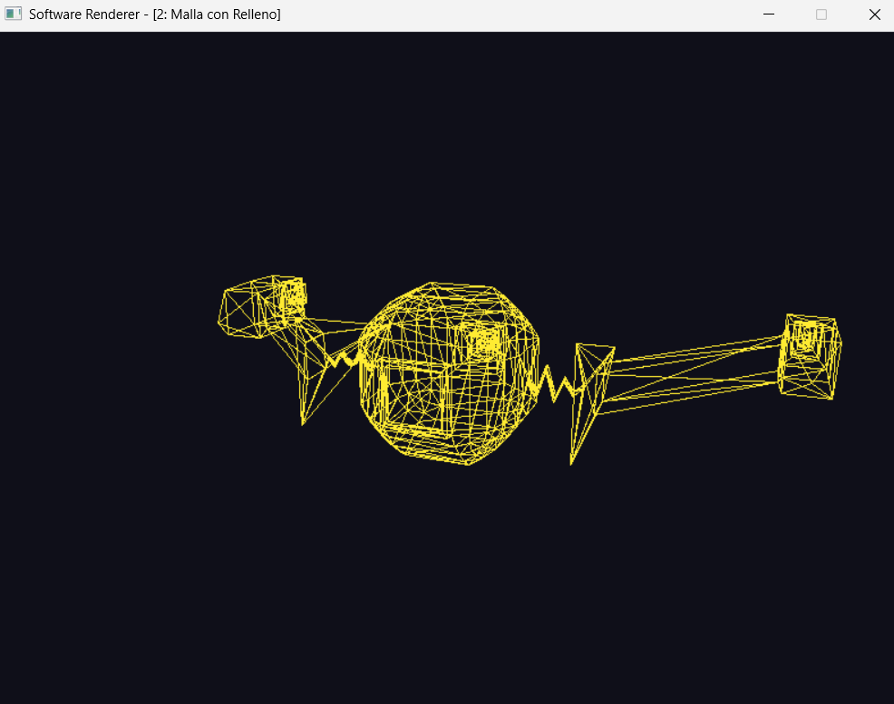
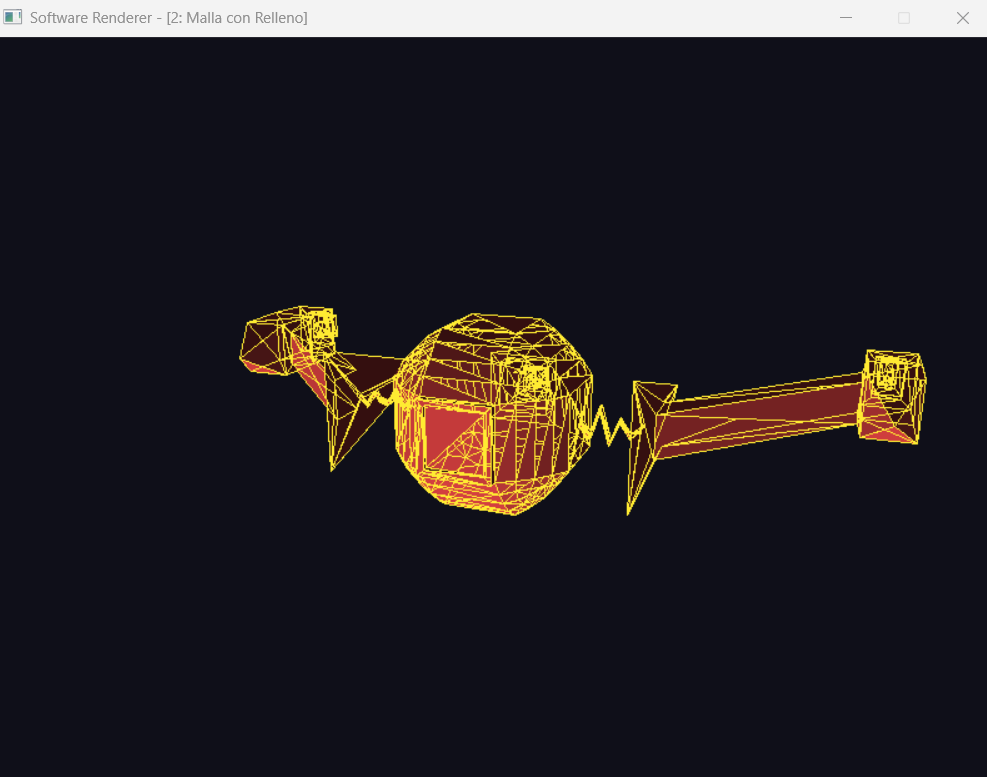
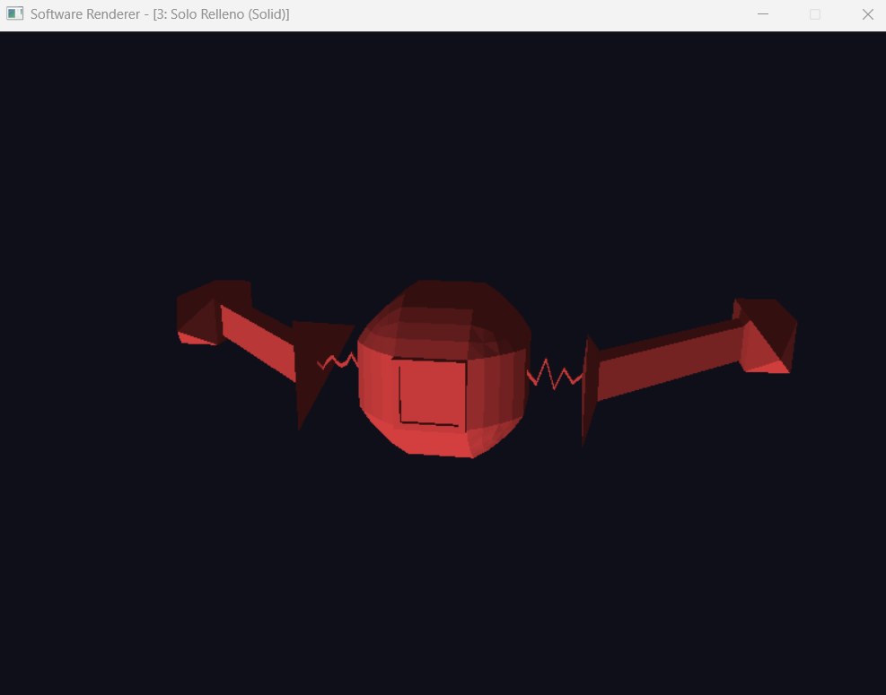

# Laboratorio 4 - Carga de modelos

Implementación de un renderizador por software en CPU desarrollado en Rust para la clase de Gráficas por Computadora.

El proyecto carga un modelo tridimensional en formato Wavefront `.obj` ([nave.obj](src/assets/nave.obj)), recorre sus caras para extraer los índices de los vértices y proyecta/rasteriza cada triángulo en pantalla utilizando un buffer de píxeles y un buffer de profundidad (*Z-Buffer*).

---

## Render del Modelo

### Modo 1: Solo Malla (Wireframe)



### Modo 2: Malla con Relleno



### Modo 3: Solo Relleno (Solid)



---

##  Requisitos y Ejecución

Tener instalado [Rust](https://www.rust-lang.org/) (edición 2024 o posterior).

### Compilar y Ejecutar en Modo Optimizado

```bash
cargo run --release
```

---

## Controles de la Aplicación

La aplicación incluye una cámara orbital interactiva y selección dinámica de modos de visualización:

| Tecla | Función |
| :---: | :--- |
| **`1`** | **Solo Malla (Wireframe):** Dibuja las aristas de los triángulos. |
| **`2`** | **Malla con Relleno:** Combina caras sólidas sombreadas con las líneas de la malla. |
| **`3`** | **Solo Relleno (Solid):** Renderizado de triángulos sólidos con iluminación y Z-Buffer. |
| **`M`** | Alternar secuencialmente entre los modos de render. |
| **`W` / `S`** o **`↑` / `↓`** | Rotar verticalmente la cámara (*Pitch*). |
| **`A` / `D`** o **`←` / `→`** | Rotar horizontalmente la cámara (*Yaw*). |
| **`E`** | Acercar cámara (*Zoom In*). |
| **`Q`** | Alejar cámara (*Zoom Out*). |
| **`Esc`** | Salir de la aplicación. |

---

## Arquitectura y Estructura del Código

El proyecto sigue una arquitectura modular:

- **`src/main.rs`**: Punto de entrada de la aplicación, configuración de ventana con `minifb`, ciclo de eventos y cálculo de delta time (`dt`).
- **`src/mesh.rs`**: Carga del modelo `.obj` y almacenamiento en memoria de la lista de vértices e índices triangulados.
- **`src/camera.rs`**: Cámara orbital en coordenadas esféricas que genera las matrices de vista (`look_at`) y proyección en perspectiva (`perspective`).
- **`src/framebuffer.rs`**: Gestión del buffer de color y el buffer de profundidad (*Z-Buffer*) en memoria CPU, con algoritmo de Bresenham para líneas.
- **`src/light.rs`**: Modelo de iluminación direccional con componentes ambiental y difusa (*Lambertian shading*).
- **`src/renderer.rs`**: Lógica de rasterizado por software usando coordenadas baricéntricas, pruebas de profundidad y dibujo de caras y aristas.